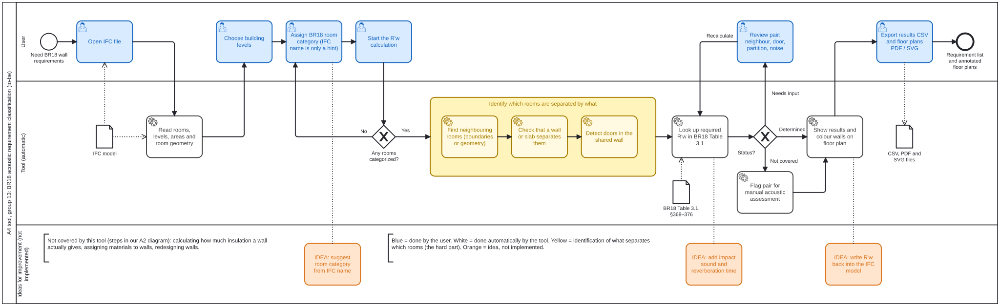
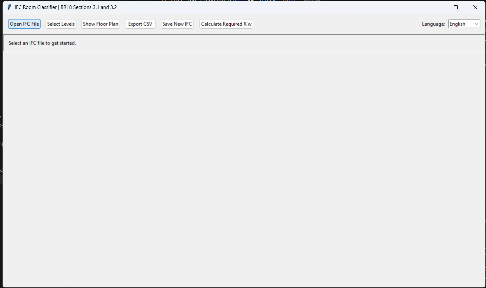
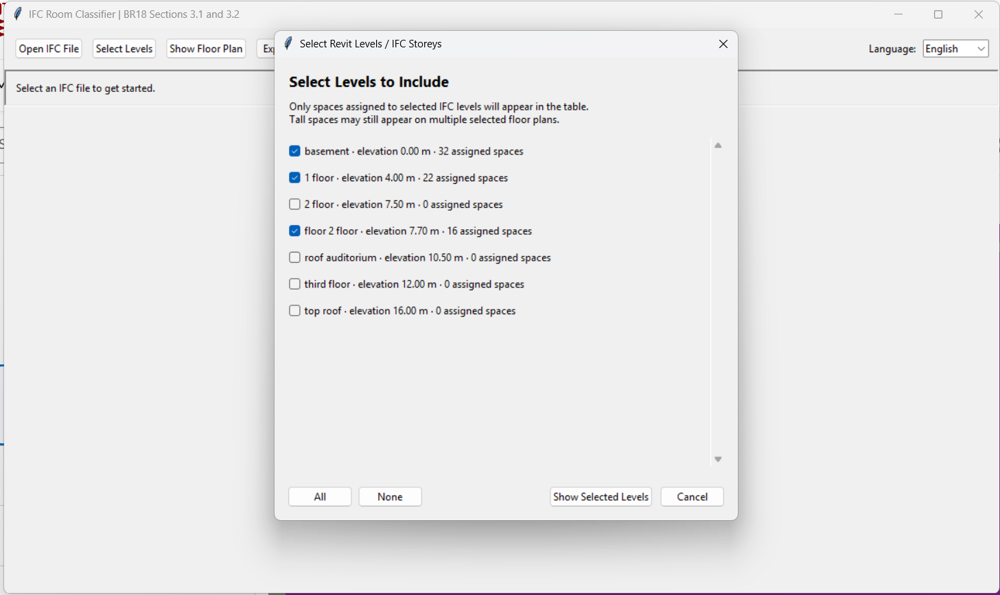
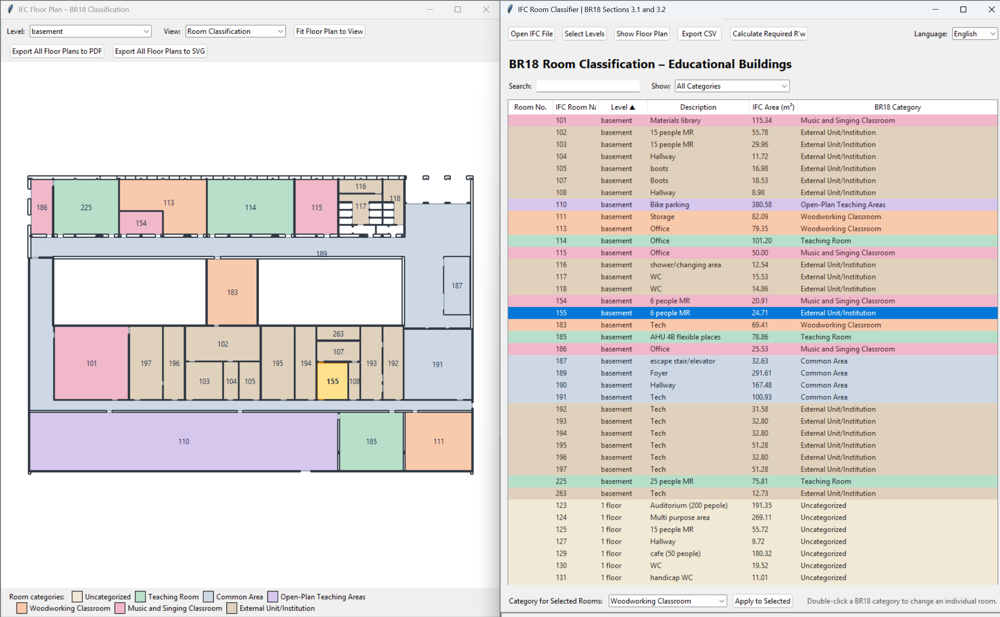
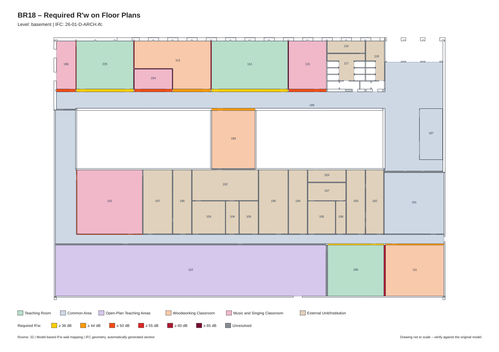

# A4: Tool – Acoustic requirement classification (BR18)

**Course:** 41934 Advanced Building Information Modeling (BIM)  
**Focus area:** Indoor & Energy -> Building acoustics. <br>
**Tool:** BR18 R'w Requirements checker <br>
**Group:** 13 <br>
**Case model:** `26-01-D-ARCH.ifc`, however the tool works on any IFC.

### What is in this A4 folder

| File | What it does |
|---|---|
| `README.md` | Describes the tool, the problem / claim it solves as well as its relation to Advanced Building Design. |
| `images/` | Figures for this README. |
| `main.py` | Starts the program, loads IFC files, allows users to select building levels and classify rooms, displays floor plans, and provides CSV, PDF and SVG export options. |
| `ifc_acoustics.py` | Finds neighbouring rooms, identifies what separates them, checks for door connections, and prepares the information needed to determine acoustic requirements. |
| `ifc_relation_analysis.py` | Checks which walls and floor slabs border each room in the IFC model to determine whether two rooms share a separating building element. Then, the verified information is passed back to `ifc_acoustics.py` for further analysis. |
| `br18_Rw_rules.py` | Contains the BR18 rules used to determine the required airborne sound insulation (R'w) between room pairs. |
| `br18_rule_labels.py` | Links calculation results to the corresponding descriptions in [BR18 §368 – §376 Guidelines for Educational Buildings, Table 3.1](https://www.bygningsreglementet.dk/tekniske-bestemmelser/17/vejledninger/undervisningsbygninger/lydisolation-for-undervisningsbygninger/#127bd002-d895-4fe3-b7c5-41d10afcf285) |
| `br18_results_ui.py` | Displays calculated R'w requirements, applicable rules, and cases requiring manual assessment in a table-format in a new window. |
| `rw_heatmap.py` | Colours the walls on the floor plan by their R'w requirement. |
| `floor_plan_export.py` | Exports floor plans with room classifications, R'w visualizations, and legends to PDF and SVG. |
| `ui_english.py` | Manages Danish and English translations of the application's interface and messages. |

[`A4A`](../A4A) contains a very simplified version of the tool, made to fit Tim's framework ([node-comply-template](https://github.com/timmcginley/node-comply-template)). It extracts information from every `IfcSpace` in the IFC model, including room number (`Number` property, or `IfcSpace.Description` as backup), IFC room name (`IfcSpace.Name`), level (`IfcBuildingStorey`), description (`IfcSpace.LongName`), and space area (`IfcQuantityArea`, using `NetFloorArea` when available, in m²), and saves the results as `result.json` located [here](https://github.com/OliverBonde/IND_26_13/tree/main/A4A/window_count/results). The full tool is in this folder (`A4`).


## 1. About the tool

### <ins>Problem / claim

**Claim to investigate:** <br>
*The designers of the building claim that the current internal separating walls, in the IFC-model, comply with the acoustic requirements of BR18 §368 - §376 for sound transmission between rooms.* (from A2)


#### Where the problem / claim was identified 

We found the claim in our A2 use-case analysis ([A2](../A2/README.md), section A2b). It concerns building 2601 (`26-01-D-ARCH.ifc`) and the sound insulation requirements in BR18 §368 – §376.

The claim cannot be checked directly, because the model contains no measured or tested wall performance. The tool therefore does the step before that check: it finds the sound insulation that BR18 requires for each interior separating wall.


### What the Tool Does and How It Is Used

The tool relies heavily on user input and is therefore intended to support, rather than replace, the acoustician. It provides an overview of the IFC building model, allowing the user to assign the appropriate function (e.g. teaching room) to each room (i.e. IfcSpace). Based on this information, the tool automatically analyzes the building model and determines the relevant acoustic requirements for airborne sound insulation (R'w) in accordance with [BR18 §368 – §376 Guidelines for Educational Buildings](https://www.bygningsreglementet.dk/tekniske-bestemmelser/17/vejledninger/undervisningsbygninger/).

### Process (BPMN)

The as-is process (the whole acoustic use case) is in our A2: [`A2/Images/diagram.svg`](../A2/Images/diagram.svg).

The to-be process with the tool is below. Blue steps are done by the user, white steps are done automatically by the tool, and the yellow box is the identification of which rooms are separated by what. Orange boxes are ideas that are not implemented. The editable file is [`A4_to-be_BPMN.bpmn`](images/A4_to-be_BPMN.bpmn).



## How to run the tool

### <ins>Step 0: Before Running the Tool</ins>

1. Ensure that **Python 3.10 or newer** is installed. We recommend using an IDE (e.g. VS Code) with the Python extension to run the tool.

2. Place all the provided Python files in the same folder.

3. Install the required Python packages by running the following command in the terminal:

   ```powershell
   python -m pip install ifcopenshell shapely reportlab
   ```

   The required packages are:
   - `ifcopenshell` – IFC model processing
   - `shapely` – Geometric analysis and visualization
   - `reportlab` – PDF export

4. Once the packages are installed, the tool is ready to run using `main.py`, as described in the following sections.


### <ins>Step 1: Run `main.py` and Load an IFC Model

Start by running `main.py` and once the user interface is loaded, select Open IFC File and choose the an IFC model of your choosing.


Figure 1. Run main.py to start program


Figure 2. [Open IFC file] and load IFC.

### <ins>Step 2: Select Levels to Include

The program prompts the user to select which building levels should be included in the analysis. This step is necessary because IFC models may contain unused levels, that are not relevant to the project.  Initially, only the levels including at least one space are selected. Additionally, the tool displays the number of spaces associated with each level to assist the user in making the correct selection.



Figure 3. Select levels to include from dialog.

### <ins>Step 3: Assign a Room function to each space


Once the desired levels are selected, the table on the right side of the figure below appears. Here, all IFC-spaces are listed with their associated number, level, description and area. This information assists the user in determining the appropriate BR18 function for the space. However, it remains the responsibility of the user to assess the intended room function and select the correct function from the drop-down menu at the bottom of the window. The descriptions, provided by the architect, serve as guidance for the acoustician when assigning the appropriate BR18 room function.

To help the user identify and locate spaces within the building, the tool generates floor plans (see the left side of the figure below) from the IFC model when "Show Floor Plan" is selected. These floor plans are created by extracting the 3D geometry of spaces and building elements, such as walls and doors, and generating horizontal sections at each selected level.

The floor plans are linked to the room classification table, allowing users to select and highlight spaces in either view. This makes it easier to understand the relationships between rooms and assign the appropriate BR18 functions.


Figure 4. Space overview and room category assignment interface.


### <ins>Step 4: Complete the Categorization of the Rooms

Using the drop-down menu at the bottom of the right side of the figure below, the rooms may be categorized based on their function. 

The example shown in the figure below is intended solely to demonstrate the tool's functionality. The IFC model (`26-01-D-ARCH.ifc`) also contains rooms that do not clearly fit any of the room types in [BR18 §368 – §376 Guidelines for Educational Buildings](https://www.bygningsreglementet.dk/tekniske-bestemmelser/17/vejledninger/undervisningsbygninger/), for example bike parking and a courtyard. The example should therefore not be interpreted as an assessment of `26-01-D-ARCH.ifc`'s actual compliance with these requirements.

**Note:** Not all spaces need to be categorized. The tool analyzes only categorized spaces and their adjacent rooms, allowing the user to determine the required R'w for a single room pair, a selected group of rooms, or all relevant interior separating walls.



Figure 5. Plan view displaying spaces and building elements.

For educational buildings, the following room categories/functions are used in the tool, based on [BR18 §368 – §376 Guidelines for Educational Buildings section 3.1 and 3.2](https://www.bygningsreglementet.dk/tekniske-bestemmelser/17/vejledninger/undervisningsbygninger/definitioner-af-rumtyper-for-undervisningsbygninger/#5036b98b-248e-48ea-8f22-d081436c63b7):

- **Teaching Rooms (Undervisningsrum)** – Classrooms, offices, group rooms, auditoriums, libraries, etc.
- **Common Areas (Fællesrum)** – Corridors, stairwells, canteens, toilets, technical rooms, etc.
- **Open-Plan Teaching Areas (Åbne undervisningsområder)** – Areas where multiple classes or groups are taught without being separated into enclosed rooms.
- **Woodworking Classrooms (Sløjdundervisningsrum)** 
- **Music and Singing Classrooms (Sang- og musikundervisningsrum)** 
- **External Units/Institutions (Eksterne enheder/institutioner)** – Adjacent rooms belonging to businesses or other institutions.
- **Uncategorized (ikke kategoriseret)** – For rooms that aren't examined or have a function yet.

### <ins>Step 5: Calculate Acoustic Requirements

Once the rooms have been categorized, press "Calculate Required R'w" to evaluate the applicable acoustic requirements for airborne sound insulation in accordance with BR18 §368 – §376.

The outcome of this is the table shown in the figure below. Here each room-pair is listed by the room number and its categorized function as well as the separation type, required R'w (i.e. the result of the calculations) and the applicable BR18 rule following [BR18 §368 – §376 Guidelines for Educational Buildings, Table 3.1](https://www.bygningsreglementet.dk/tekniske-bestemmelser/17/vejledninger/undervisningsbygninger/lydisolation-for-undervisningsbygninger/#127bd002-d895-4fe3-b7c5-41d10afcf285).

In some instances the required R'w can't be determined directly for BR18 §368 – §376, meaning that a manual assessment is needed. This can be due to the specific combination of the two rooms not being present in BR18 §368 – §376. It can also be due to a lacking user input from the acoustician regarding flexible partitions and/or whether there is "particularly disturbing noise (særligt generende støj)" in one of the two rooms. The latter of the two is for instance relevant in the case of Teaching rooms being adjacent to External Units/Institutions.


Figure 6. Calculation of acoustic requirements based on the assigned room functions. Horizontal separation type means that the rooms are adjacent on the same floor (i.e. they share at least one wall). Vertical would mean that one of the rooms is above/below the other (i.e. on a different floor).

### <ins>Step 6: Review and Export Results

After the calculations have been completed, the results can be visualized directly in the plan view. The data can also be exported for further documentation, review, and integration into the acoustic design process.



Figure 7. Visualization and export of calculated acoustic requirements.


## 2. Advanced Building Design

**Stage:** mainly B and C, when the room layout is mostly fixed but the walls can still change. In stage D it can be used to check the final model.

**Who could use it:**
- Acoustic engineers, to get the BR18 requirement for every room pair at once.
- Architects, to see early which walls need high sound insulation.
- Engineers choosing wall types, who need the required R'w as input.

**What the model must contain:**

| IFC information | Used for |
|---|---|
| `IfcBuildingStorey` | Identifying and selecting building levels. |
| `IfcSpace` with geometry | Identifying rooms, their locations and shapes for floor plans and adjacency detection. Room names and descriptions are displayed to help the user. |
| `IfcSpace` area quantities | Displaying room areas in the room classification table. |
| `IfcWall` and `IfcSlab` | Identifying and verifying walls and floor slabs separating adjacent rooms. |
| `IfcDoor` and associated openings | Detecting direct door connections, which can affect the required R'w. |
| `IfcRelSpaceBoundary` (optional) | Identifying room boundaries and shared building elements. If unavailable, the tool uses geometry to detect adjacency. |

The most important requirement is that rooms are represented as `IfcSpace` objects with usable geometry. Walls, slabs and door information are needed for reliable acoustic analysis, while `IfcRelSpaceBoundary` is optional.

Room functions are not automatically read from the IFC model. Instead, the user assigns the relevant BR18 room categories.


## Limitations of the tool

- The tool gives the required R'w. It does not calculate how much a wall actually insulates, so it cannot show that a wall complies.
- If a room gets assigned an incorrect function, the calculated R'w requirements will be wrong.
- Without space boundaries (i.e. `IfcRelSpaceBoundary`) in the model, neighbouring rooms are found from geometry. These results should be checked against the building plans by the user (e.g. acoustician).
- Only the BR18 rules for educational buildings are included.
- Some room combinations are not explicitly covered by [BR18 §368 – §376 Guidelines for Educational Buildings, Table 3.1](https://www.bygningsreglementet.dk/tekniske-bestemmelser/17/vejledninger/undervisningsbygninger/lydisolation-for-undervisningsbygninger/#127bd002-d895-4fe3-b7c5-41d10afcf285) and therefore require manual assessment.
- Some requirements depend on additional user input, such as whether a partition is flexible or whether particularly disturbing noise is present.
- Missing or incorrectly modelled doors and openings in the IFC model may lead to incorrect or uncertain R'w requirements.
- The tool only evaluates airborne sound insulation (R'w). Other acoustic requirements, such as impact sound insulation and reverberation time, are not considered (which they should in a real acoustic design process).

## Acknowledging the use of AI
The development of the tool was AI-assisted, particularly in creating the user interface and thus improving the user experience. We believed that creating an intuitive and easy-to-use tool would provide greater value than requiring users to interact with the program through the terminal. AI was therefore used to support the development of a more accessible, functional, and user-friendly tool.

## References

- BR18, guidance for educational buildings, 3.1 Room type definitions: https://www.bygningsreglementet.dk/tekniske-bestemmelser/17/vejledninger/undervisningsbygninger/definitioner-af-rumtyper-for-undervisningsbygninger/
- BR18, guidance for educational buildings, 3.2 Sound insulation, Table 3.1: https://www.bygningsreglementet.dk/tekniske-bestemmelser/17/vejledninger/undervisningsbygninger/lydisolation-for-undervisningsbygninger/

## Licence

GPL-3.0
