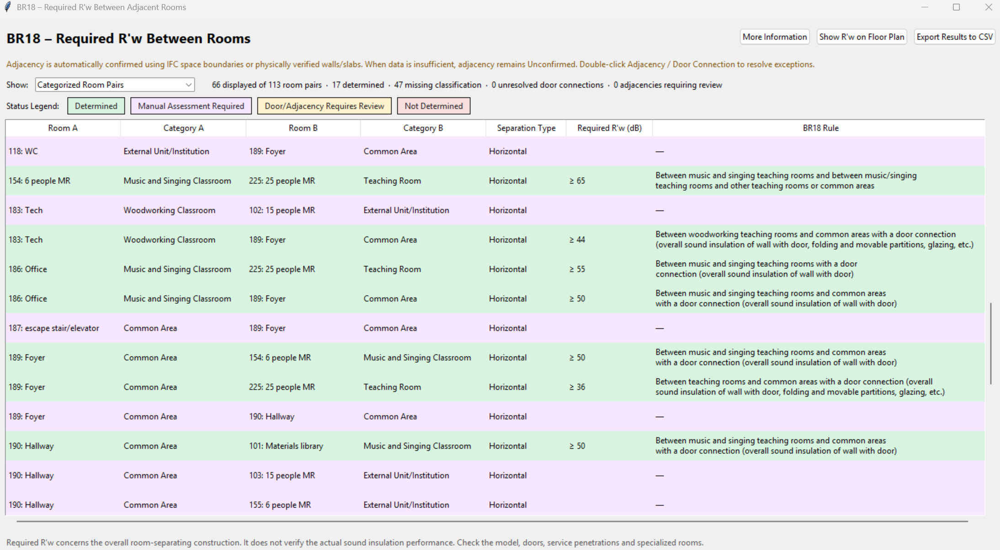

# A4: Tool – Acoustic requirement classification (BR18)

**Course:** 41934 Advanced Building Information Modeling (BIM)  
**Focus area:** Building acoustics / architectural design  
**Tool:** BR18 R'w Requirements checker <br>
**Group:** 13 <br>
**Case model:** `26-01-D-ARCH.ifc`, however the tools works on any IFC.

## 1. About the tool

### <ins>Problem / claim

**Claim to investigate:** <br>
*The designers of the building claim that the current internal separating walls, in the IFC-model, comply with the acoustic requirements of BR18 §368 - §376 for sound transmission between rooms.* (from A2)


#### Where the problem / claim was indentified 

The problem/claim isn't found in a particular IFC-file, since no measured/tested wall performance has been supplied/calculated. Instead, the sound insulation requirements for interior separating walls in a given IFC-file are established.


### What the Tool Does and How It Is Used

The tool relies heavily on user input and is therefore intended to support, rather than replace, the acoustician. It provides an overview of the IFC building model, allowing the user to assign the appropriate function (e.g. teaching room) to each room (i.e. IfcSpace). Based on this information, the tool automatically analyzes the building model and determines the relevant acoustic requirements for airborne sound insulation (R'w) in accordance with [BR18 §368 – §376 Guidelines for Educational Buildings](https://www.bygningsreglementet.dk/tekniske-bestemmelser/17/vejledninger/undervisningsbygninger/).

## How to run the tool

### <ins>Step 0: Before Running the Tool</ins>

1. Ensure that **Python 3.10 or newer** is installed. We recommend using an IDE (e.g. VS Code) with the Python extension to run the tool.

2. Place all the provided Python files in the same folder.

3. Install the required Python packages by running the following command in the terminal:

   ```powershell
   python -m pip install ifcopenshell shapely reportlab
   ```

   The required packages are:
   - `ifcopenshell` – IFC model processing
   - `shapely` – Geometric analysis and visualization
   - `reportlab` – PDF export

4. Once the packages are installed, the tool is ready to run using `main.py`, as described in the following sections.


### <ins>Step 1: Run `main.py` and Load an IFC Model

Start by running `main.py` and once the user interface is loaded, select Open IFC File and choose the an IFC model of your choosing.


Figure 1. Run main.py to start program


Figure 2. [Open IFC file] and load IFC.

### <ins>Step 2: Select Levels to Include

The program prompts the user to select which building levels should be included in the analysis. This step is necessary because IFC models may contain unused levels, that are not relevant to the project.  Initially, only the levels including at least one space are selected. Additionally, the tool displays the number of spaces associated with each level to assist the user in making the correct selection.


Figure 3. Select levels to include from dialog.

### <ins>Step 3: Assign a foom function to each space


Once the desired levels are selected, the table on the right side of the figure below appears. Here, all IFC-spaces are listed with their associated number, level, description and area. This information assists the user in determining the appropriate BR18 function for the space. However, it remains the responsibility of the user to assess the intended room function and select the correct function from the drop-down menu at the bottom of the window. The descriptions, provided by the architect, serve as guidance for the acoustician when assigning the appropriate BR18 room function.

To help the user identify and locate spaces within the building, the tool generates floor plans (see the left side of the figure below) from the IFC model when "Show Floor Plan" is selected. These floor plans are created by extracting the 3D geometry of spaces and building elements, such as walls and doors, and generating horizontal sections at each selected level.

The floor plans are linked to the room classification table, allowing users to select and highlight spaces in either view. This makes it easier to understand the relationships between rooms and assign the appropriate BR18 functions.


Figure 3. Space overview and room category assignment interface.


### <ins>Step 4: Complete the Categorization of the Rooms

Using the drop-down menu at the bottom of the right side of the figure below, the rooms may be categorized based on their function. 

The example shown in the figure below is intended solely to demonstrate the tool's functionality. The IFC model (`26-01-D-ARCH.ifc`) contains offices and other room functions that are not covered in [BR18 §368 – §376 Guidelines for Educational Buildings](https://www.bygningsreglementet.dk/tekniske-bestemmelser/17/vejledninger/undervisningsbygninger/). Therefore, the example should not be interpreted as an assessment of `26-01-D-ARCH.ifc`'s actual compliance with these requirements.

**Note:** Not all spaces need to be categorized. The tool analyzes only categorized spaces and their adjacent rooms, allowing the user to determine the required R'w for a single room pair, a selected group of rooms, or all relevant interior separating walls.


Figure 4. Plan view displaying spaces and building elements.

For educational buildings, the following room categories/functions are used in the tool, based on [BR18 §368 – §376 Guidelines for Educational Buildings section 3.1 and 3.2](https://www.bygningsreglementet.dk/tekniske-bestemmelser/17/vejledninger/undervisningsbygninger/definitioner-af-rumtyper-for-undervisningsbygninger/#5036b98b-248e-48ea-8f22-d081436c63b7):

- **Teaching Rooms (Undervisningsrum)** – Classrooms, offices, group rooms, auditoriums, libraries, etc.
- **Common Areas (Fællesrum)** – Corridors, stairwells, canteens, toilets, technical rooms, etc.
- **Open-Plan Teaching Areas (Åbne undervisningsområder)** – Areas where multiple classes or groups are taught without being separated into enclosed rooms.
- **Woodworking Classrooms (Sløjdundervisningsrum)** 
- **Music and Singing Classrooms (Sang- og musikundervisningsrum)** 
- **External Units/Institutions (Eksterne enheder/institutioner)** – Adjacent rooms belonging to businesses or other institutions.
- **Uncategorized (ikke kategoriseret)** – For rooms that aren't examined or have a function yet.

### <ins>Step 5: Calculate Acoustic Requirements

Once the rooms have been categorized, press "Calculate Required R'w" to evaluate the applicable acoustic requirements for airborne sound insulation in accordance with BR18 §368 – §376.

The outcome of this is the table shown in the figure below. Here each room-pair is listed by the room number and its categorized function as well as the separation type, required R'w (i.e. the result of the calculations) and the applicable BR18 rule following [BR18 §368 – §376 Guidelines for Educational Buildings, Table 3.1](https://www.bygningsreglementet.dk/tekniske-bestemmelser/17/vejledninger/undervisningsbygninger/lydisolation-for-undervisningsbygninger/#127bd002-d895-4fe3-b7c5-41d10afcf285).

In some instances the required R'w can't be determined directly for BR18 §368 – §376, meaning that a manual assessment is needed. This is can be due to the specific combination of the two rooms not being present in BR18 §368 – §376. It can also be due to a lacking user input from the acoustician regarding flexible partitions and/or whether there is "particularly disturbing noise (særligt generende støj)" in one of the two rooms. The latter of the two is for instance relevant in the case of Teaching rooms being adjacent to External Units/Institutions.




Figure 5. Calculation of acoustic requirements based on the assigned room functions. Horizontal separation type means that the rooms are adjacent on the same floor (i.e. they share at least one wall). Vertical would mean that one of the rooms is above/below the other (i.e. on a different floor).

### <ins>Step 6: Review and Export Results

After the calculations have been completed, the results can be visualized directly in the plan view. The data can also be exported for further documentation, review, and integration into the acoustic design process.


Figure 6. Visualization and export of calculated acoustic requirements.


### What is in this folder

| File | What it does |
|---|---|
| `main.py` | Starts the program. Opens the IFC file, lets the user choose levels and room categories, shows the floor plans, and exports CSV, PDF and a new IFC with the room categories. |
| `ifc_acoustics.py` | Finds which rooms are next to each other and whether there is a door between them. |
| `ifc_relation_analysis.py` | Checks that a wall or slab actually separates the two rooms. |
| `br18_Rw_rules.py` | The BR18 rules. Gives the required R'w for a room pair. |
| `br18_rule_labels.py` | The text shown for each BR18 rule. |
| `br18_results_ui.py` | The results window. |
| `rw_heatmap.py` | Colours the walls on the floor plan by their R'w requirement. |
| `floor_plan_export.py` | Exports the floor plans as SVG. |
| `ui_english.py` | English text for the interface. |
| `images/` | Figures for this README. |

A simplified version without the interface, made for the course's starter framework, is in [`A4A`](../A4A).

## 2. Advanced Building Design

**Stage:** mainly B and C, when the room layout is mostly fixed but the walls can still change. In stage D it can be used to check the final model.

**Who could use it:**
- Acoustic engineers, to get the BR18 requirement for every room pair at once.
- Architects, to see early which walls need high sound insulation.
- Engineers choosing wall types, who need the required R'w as input.

**What the model must contain:**

| IFC information | Used for |
|---|---|
| `IfcBuildingStorey` | Choosing which levels to include |
| `IfcSpace` with geometry | The rooms and the floor plans. Name and description are shown to help the user. |
| `IfcWall` and `IfcSlab` | Walls between rooms side by side, slabs between rooms above each other |
| `IfcDoor` in a wall opening | Doors change the requirement |
| `IfcRelSpaceBoundary` (optional) | Used first if the model has it. Otherwise the tool works from geometry. |

Room functions are not read from the model. The user assigns them.

## Limitations

- The tool gives the required R'w. It does not calculate how much a wall actually insulates, so it cannot show that a wall complies.
- If a room gets the wrong category, its requirements will be wrong.
- Without space boundaries in the model, neighbouring rooms are found from geometry. Check these results against the plans.
- Only the BR18 rules for educational buildings are included.

## References

- BR18, guidance for educational buildings, 3.1 Room type definitions: https://www.bygningsreglementet.dk/tekniske-bestemmelser/17/vejledninger/undervisningsbygninger/definitioner-af-rumtyper-for-undervisningsbygninger/
- BR18, guidance for educational buildings, 3.2 Sound insulation, Table 3.1: https://www.bygningsreglementet.dk/tekniske-bestemmelser/17/vejledninger/undervisningsbygninger/lydisolation-for-undervisningsbygninger/
- 41934 A4: Tool: https://timmcginley.github.io/41934/Assignments/A4.html

## Licence

GPL-3.0